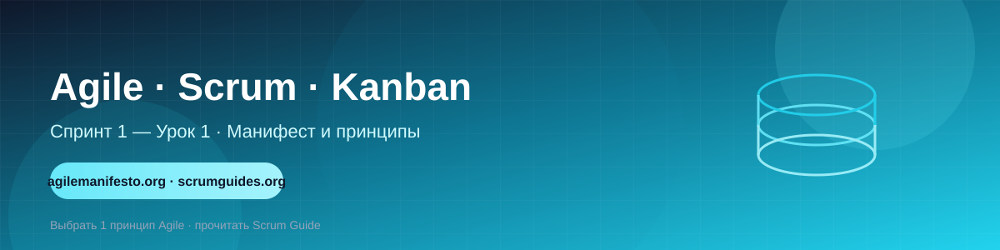
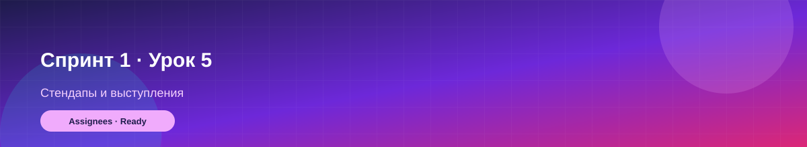
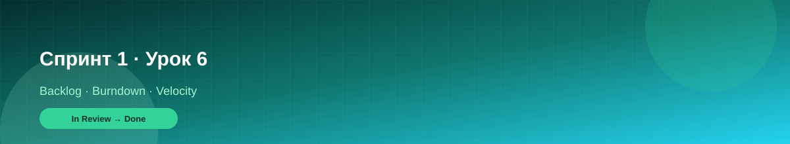

# S: CRUM-Project

> ### Спринт 1 · Урок 1 · `Agile` `Scrum`
>
> **Манифест Agile и Scrum Guide**
>
> Прочитайте 12 принципов на [agilemanifesto.org](https://agilemanifesto.org), выберите один — самый близкий, и посетите [scrumguides.org](https://scrumguides.org).
>
> 📤 **Сдать:** текст выбранного принципа + короткий вывод по Scrum Guide.

> ### Спринт 1 · Урок 2 · `Вакансии` `Рынок`
>
> **Agile на рынке труда**
>
> Найдите любое объявление о найме с упоминанием Agile / Scrum / Kanban и сделайте скриншот.
>
> 📤 **Сдать:** скриншот вакансии + 1–2 предложения, почему она Agile-ориентирована.

> ### Спринт 1 · Урок 3 · `GitHub` `Команда`
>
> **Команда, продукт, GitHub**
>
> Соберите команду, определите цель продукта (тематика и стек), создайте репозиторий на GitHub, добавьте участников, создайте Project и `README.md` с составом и описанием продукта.
>
> 📤 **Сдать:** ссылку на репозиторий + скриншот Project + README.

> ### Спринт 1 · Урок 4 · `Планирование` `Milestones` `Issues`
>
> **Планирование проекта. Композиция спринта**
>
> В репозитории с проектом создайте **Milestone «Спринт 1»** (в Issues → Milestones; используется и для PR) и **Issues** на весь спринт — столько задач, сколько реально планируете выполнить до **первого прототипа (3 дня)**. Каждая задача — отдельный Issue с понятным названием и описанием.
>
> 📤 **Сдать:** ссылку на Milestone + список Issues спринта (скриншот или ссылка на фильтр `is:issue milestone:"Спринт 1"`).

> ### Спринт 1 · Урок 5 · `Стендап` `Роли` `Ready`
>
> **Стендапы и выступления**
>
> Назначьте ответственных по задачам спринта: в Project распределите все (или часть) Issues между членами команды. После назначения перенесите карточки в колонку **`Ready`**.
>
> 📤 **Сдать:** скриншот Project, где у задач есть assignee и они в `Ready` + короткий план стендапа (кто, когда, что говорит).

> ### Спринт 1 · Урок 6 · `Backlog` `Burndown` `Velocity`
>
> **Формирование backlog и заполнение задачами**
>
> К этому моменту задачи в Project — в колонке `Ready`. Приступая к работе, переносите их в **`In Progress`**.
>
> **Product Owner** (владелец репозитория или выбранный роль) переносит шаблон [`burndown_velocity_template.xlsx`](https://github.com/TopCollegeTCF/SCRUM-Project/blob/main/docs/burndown_velocity_template.xlsx) в свой репозиторий и форматирует по договорённости: **6 часов в спринте = 1 день спринта** в таблице. По окончании спринта PO подсчитывает все задачи и расставляет их по колонкам аналогично шаблону.
>
> **Разработчики** реализуют требования задач, после завершения переносят карточку в **`In Review`**. Тестируют на этой стадии сами; после успешного тестирования — переносят в **`Done`** и **закрывают Issue**.
>
> 📤 **Сдать:** ссылку на заполненный `burndown_velocity_template.xlsx` в вашем репозитории + скриншот Project с задачами в `In Review` / `Done`.

---

## 💼 Проекты команды

| Проект | Репозиторий | Стек / тема |
|---|---|---|
| **WK 2.0** |  | — |
| **ScrumDrop** |  | — |
| **FamilyCaze** |  | — |
| **Grande Course** |  | — |

---

## 🔰 Быстрая навигация

