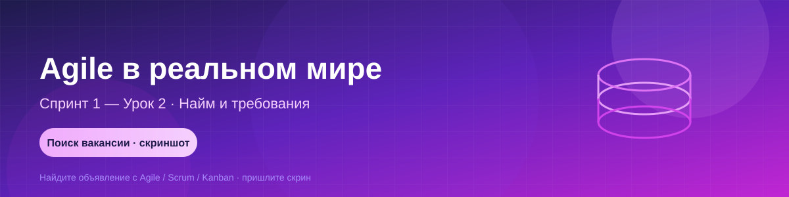

# SCRUM-Project

  

  

  
Спринт 1 · Урок 1

  
Манифест Agile и Scrum Guide

  
Прочитайте 12 принципов на <a href="https://agilemanifesto.org" style="color:#67e8f9;text-decoration:none;">agilemanifesto.org</a>, выберите один — самый близкий, и посетите <a href="https://scrumguides.org" style="color:#67e8f9;text-decoration:none;">scrumguides.org</a>.

  
<b style="color:#e2e8f0;">Сдать:</b> текст выбранного принципа + короткий вывод по Scrum Guide.

  

  

  
Спринт 1 · Урок 2

  
Agile на рынке труда

  
Найдите любое объявление о найме с упоминанием Agile / Scrum / Kanban и сделайте скриншот.

  
<b style="color:#f5d0fe;">Сдать:</b> скриншот вакансии + 1–2 предложения, почему она Agile-ориентирована.

  

  

  
Спринт 1 · Урок 3

  
Команда, продукт, GitHub

  
Соберите команду, определите цель продукта (тематика и стек), создайте репозиторий на GitHub, добавьте участников, создайте Project и <code style="background:rgba(190,242,100,0.18);color:#d9f99d;padding:1px 5px;border-radius:4px;font-size:12px;">README.md</code> с составом и описанием продукта.

  
<b style="color:#ecfccb;">Сдать:</b> ссылку на репозиторий + скриншот Project + README.

